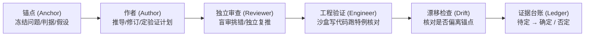

# 自动科研系统（Auto-Research System）

> **把一整本博士论文或复杂科研课题，拆解为“论文框架 → 章节 → 小问题（微型论文）”，由多模型异构协同推进、盲审挑错、沙盒代码验证与证据台账归档的本地科研工作台。**

[-blue.svg)](https://www.python.org/)
[](LICENSE)

---

## 为什么做这个系统？

直接用聊天窗口让 AI 写论文或做推导，最容易遇到四个致命问题：
1. **越聊越跑偏**：几轮对话后 AI 悄悄改了前提假设或把目标换成了更容易的题。
2. **自家模型护短**：同一个模型自己写、自己审，很难发现深层逻辑漏洞或符号错误。
3. **空口说对、抄错数字**：没有真正跑代码核对特例，或者把实验结果抄进正文时写错数字。
4. **过程散落、无法追溯**：几十次对话散落在不同网页和终端里，几个月后连自己都找不到某条结论是怎么来的。

本系统将 **防跑偏机制** 固化为本地工作流，零第三方 Python 依赖（纯标准库），所有研究资料全部以纯文本 **Markdown (`.md`) + JSON** 保存在你的本地文件夹中，并由 Git 自动做版本管理。

---

## 核心特性

### 1. 三层结构化拆解
- **论文框架层 (`FW` / `F01`)**：明确整篇论文的核心科学问题、主线主张与 7 章结构。
- **章节层 (`C01`–`C07`)**：绪论、理论推导、研究问题（支持 S1 量化缺口 → S2 发散想法 → S3 可行性筛选 → S4 查新 → S5 最小证伪实验 → S6 拆小问题）、总结与展望。
- **小问题层 (`C04-Q01`)**：每个具体研究问题按一篇**五节微型论文**（1 问题与假设 → 2 理论推导 → 3 验证方案 → 4 验证结果 → 5 结论与适用范围）扎实推进。

### 2. 防跑偏四件套

- **锚点 (`锚点.md`)**：开工前先由你确认问题、判据、假设、范围与非目标。AI 无权私自修改锚点，若需调整必须发起变更申请等你批准。
- **证据台账 (`台账.md`)**：AI 提出的任何论断默认都是 **“待定”**；只有挂载了通过检验的运行结果 (`R01`)、不同模型家族的独立复推 (`V01`) 或你亲自核对过 DOI/arXiv 的文献，系统程序才会将其升为 **“确定”**。
- **跨家族异构互审**：系统强制要求 **作者** 与 **审查 / 漂移检查 / 审稿** 来自不同模型家族（如 GPT 写、Gemini 审、Claude 查漂移），且审查者看不到之前的赞成意见，只做盲审。
- **结果数字防抄错**：正文通过 `{{result:R01:max_error}}` 引用实验输出 JSON 中的数值，由系统直接渲染并带来源角标，杜绝 AI 抄错实验数据。

### 3. 自由选择各角色模型与推理强度
- 支持三大主流本地 AI 命令行工具：
  - **OpenAI Codex CLI (`codex`)**：使用 ChatGPT 订阅额度，支持沙盒工程代码执行。
  - **Google Antigravity CLI (`agy`)**：使用 Google 订阅额度（仅调用 Gemini 模型，安全合规）。
  - **Claude Code CLI (`claude`)**：支持官方订阅或独立 API 中转站（支持单次与月度美元预算上限）。
- 在网页 **“设置 → 角色与模型”** 或右侧 **“下一轮”** 面板中，可随时为 6 个角色分别选择**首选模型**、**推理强度（`low` / `medium` / `high` / `xhigh` / `max` / `ultra`）**以及**备选替补模型**。
- **对话全量本地留档**：每一轮发给所有 AI 的完整提示词（`.提示词.md`）、AI 原始回复（`.md`）与轮次简报（`简报.md`）全部保存在对应条目的 `轮次/` 文件夹中，网页端可一键在资源管理器中打开。

---

## 快速开始

### 方式一：让你的 AI 助手一键自动配置（推荐）

克隆本仓库后，用你常用的 AI 编程工具（Claude Code / Codex / Cursor / Antigravity）打开本目录，直接对它说：

> **请阅读 `AI一键配置指南.md`，帮我自动检测本机已安装的模型工具，生成 `00_模型与额度.json` 并启动系统。**

或者直接在终端运行自动检测配置脚本：
```bash
py -3.12 -X utf8 tools/auto_configure.py
```
详见 **[AI一键配置指南.md](AI一键配置指南.md)**。

### 方式二：手动启动

1. **环境要求**：Python 3.11 或 3.12（零第三方依赖，仅用标准库），Git。
2. **启动正式工作台**：
   - Windows：双击 **`启动科研文件管理系统.cmd`**（或 **`打开科研文件管理系统.cmd`**）
   - 命令行：
     ```bash
     py -3.12 -X utf8 nb.py serve --root . --port 8787
     ```
   - 浏览器访问：`http://127.0.0.1:8787`
3. **打开自带演示项目（体验完整流程）**：
   - 双击 **`打开示例研究.cmd`**（运行在 `http://127.0.0.1:8788`），或直接点击网页右上角 **「演示数据」**（`http://127.0.0.1:8787/?mock=1`）预览完整的 7 章博士论文示例。

### 方式三：15 分钟从零上手教程（附可直接复制的提示词）

不知道打开空白页面后第一步点哪里、写什么？请直接阅读 **[快速上手示例.md](快速上手示例.md)**（或在网页右上角点击 **「上手示例」** 按钮），内含从 **定全篇锚点 → 生成 7 章候选框架 → 第 2 章五节小论文推导 → 第 3–5 章 S1–S6 创新漏斗** 的每一步点击位置与可直接复制粘贴的提示词模板。

---

## 目录结构

```text
.
├── 00_项目卡.md                # 论文全局背景、符号约定、已有数据位置
├── 00_模型与额度.json          # 各角色模型、推理强度、额度上限与 Git 同步设置
├── 01_论文框架/                # 论文框架层（锚点、台账、候选框架、轮次记录）
├── 02_研究内容/                # 各章节与小问题（草稿、推导笔记、代码、验证结果、独立复推）
├── 03_提示词/                  # 提示词模板库
├── 示例研究/                   # 自带完整演示项目（三步相移解调与二次谐波反例）
├── notebook/                   # Python 后端（零第三方依赖：模型调度、讨论引擎、台账、Git 版本）
├── static/v2/                  # 前端工作台界面（原生 ES6 + 内置 KaTeX 数学公式渲染）
├── tools/auto_configure.py     # 本机 AI 命令行工具自动检测与配置生成脚本
├── tests/                      # 完整单元测试套件（使用 fake_cli 模拟，零额度消耗）
├── AI一键配置指南.md           # 复制即用的 AI 自动配置提示词
├── 快速上手示例.md             # 15 分钟从零开始实操教程（含各阶段可复制提示词模板）
├── 工作流说明.md               # 分层讨论、防跑偏机制与各章推进法详解
├── 使用说明.md                 # 界面操作指南
└── IMPLEMENTATION.md           # 架构与接口维护文档
```

---

## 隐私与安全设计

1. **绝不触碰或上传任何密钥**：系统不存储 API Key，所有调用直接复用本机 CLI 工具自身的登录态，且在启动子进程前自动剥离父进程环境中的敏感变量。
2. **Git 提交敏感词拦截**：内置正则扫描（`sk-*`、`Bearer`、`ANTHROPIC_AUTH_TOKEN`、`refresh_token` 等）与单文件体积检查（>50 MB 自动拦截），防止密钥或大型原始实验数据误入 Git 仓库。
3. **仅监听本机回环地址**：Web 服务强制绑定 `127.0.0.1`，并校验 `Host`、`Origin`、`Sec-Fetch-Site` 与自定义请求头，拒绝任何跨站或局域网外部请求。
4. **私密论文建议使用私有仓库**：在开始撰写你自己的未发表论文前，请在 GitHub 新建一个 **Private（私有）** 仓库，并在网页右上角 **“设置 → 版本管理”** 中绑定你的私有仓库地址。

---

## 运行测试

```bash
py -3.12 -X utf8 -m unittest discover -s tests -q
```

## 开源许可

本项目采用 [MIT License](LICENSE) 开源。内置数学公式渲染库 KaTeX 遵循 MIT 许可（详见 [第三方组件.md](第三方组件.md)）。
